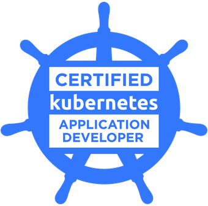
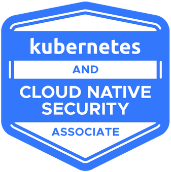

# Alexander Hossak

**Kubernetes platform & security engineer.** I build Kubernetes platforms that are secure by default, reproducible from code, and boring to operate.

> Computing since I was 8 years old. The web and my ADHD did the rest.

Over 30 years with computers, in professional IT since 2000. I know Linux, macOS and Windows inside out.

  
  
  
  
  

---

### What I work on

- **Kubernetes platforms.** Highly available, fully declarative clusters on Talos Linux: bare metal, immutable nodes, no SSH, API access over mTLS only.
- **Platform security.** Default-deny networking with Cilium up to layer 7, Kyverno admission policies, Falco runtime detection, signed images, Trivy in CI, regular checks against the CIS Kubernetes Benchmark.
- **Reliability.** Monitoring and alerting with Prometheus, Grafana and Loki, exercised disaster-recovery restores, postmortems, and 24/7 on-call for production systems.
- **AI infrastructure.** Self-hosted LLM inference, knowledge-graph memory servers for coding agents over MCP, and LLM routing through a central gateway.

### Selected work

- Designed and ran the migration of a healthcare IoT company's container platform to a highly available Talos Linux cluster with Cilium, Kyverno, Falco and Rook-Ceph.
- Modernised the company's entire production Linux infrastructure: every server and LXC container moved off end-of-life Ubuntu 16.04 to Rocky Linux 9 and Docker Compose, fully automated with Ansible.
- Moved a multi-terabyte production PostgreSQL 10 database to a highly available PostgreSQL 16 cluster (Patroni, etcd).
- Introduced secret management: hard-coded credentials removed from the code repositories, repositories sanitised, exposed passwords and keys rotated.
- Kept more than 7,500 IoT gateways running in hospitals worldwide.

### Currently building

- **cf-ai-edge-demo**: a retrieval-augmented question-answering API on Cloudflare's edge (Workers AI, AI Gateway, Vectorize), protected by Cloudflare Access and a WAF rate limit, with measured latency and cost per request.
- **Homelab**: an 8-node Raspberry Pi 4B Kubernetes cluster and a dedicated Proxmox server as a remote lab.

### Stack

**Kubernetes:** Talos Linux · Cilium · Kyverno · Falco · Rook-Ceph · Argo CD · K3s · GKE 
**Automation:** Ansible · Terraform · Packer · GitLab CI/CD · GitHub Actions 
**Observability:** Prometheus · Grafana · Loki · Zabbix 
**Systems:** Linux · PostgreSQL · WireGuard · Active Directory · Keycloak 
**Languages:** Python · Go · Bash

### Contact

[LinkedIn](https://www.linkedin.com/in/alexander-hossak) · [Credly](https://www.credly.com/users/alexander-hossak) · [certdirectory](https://certdirectory.io/profile/alexander-hossak)
