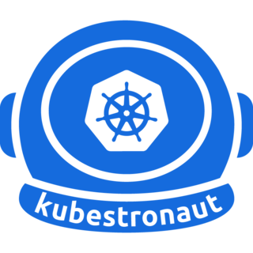
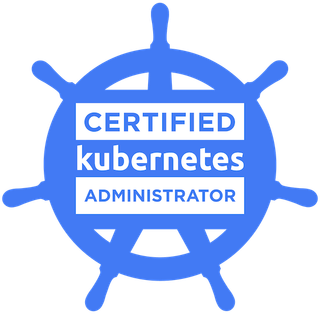
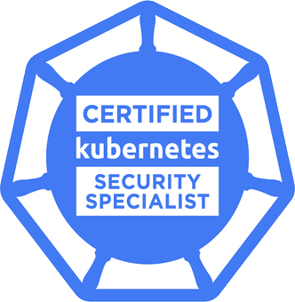
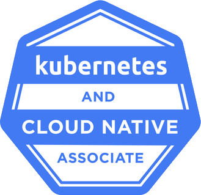

  
  
  
  
  
  

I build Kubernetes platforms that are **secure by default, reproducible from code, and boring to operate**, and I run AI agents on infrastructure I control. I like to sit with the people who use a system, find the real problem, and ship the fix.

> Computing since I was 8. In professional IT since 2000. Linux, macOS and Windows, inside out.

---

### 🧭 What I do

| | |
|---|---|
| **Kubernetes platforms** | Highly available, fully declarative clusters on Talos Linux. Bare metal, immutable nodes, no SSH, API access over mTLS only. |
| **Platform security** | Default-deny networking with Cilium up to layer 7, Kyverno admission policies, Falco runtime detection, signed images, Trivy in CI, CIS Kubernetes Benchmark checks. |
| **Reliability** | Prometheus, Grafana and Loki, exercised disaster-recovery restores, postmortems, 24/7 on-call for production systems. |
| **AI-native engineering** | Self-hosted LLM inference, an LLM routing gateway, and knowledge-graph memory servers that coding agents use over MCP. Agents are part of how I build, review and operate every day. |

### 🏥 Selected work

- **Talos migration.** Designed and ran the move of a healthcare IoT company's container platform to a highly available Talos Linux cluster with Cilium, Kyverno, Falco and Rook-Ceph.
- **Fleet modernisation.** Every production server and LXC container moved off end-of-life Ubuntu 16.04 to Rocky Linux 9 and Docker Compose, fully automated with Ansible.
- **Database HA.** A multi-terabyte PostgreSQL 10 database moved to a highly available PostgreSQL 16 cluster on Patroni and etcd.
- **Secrets clean-up.** Hard-coded credentials removed from the code, repositories sanitised, exposed passwords and keys rotated.
- **Scale.** Kept more than 7,500 IoT gateways running in hospitals worldwide.

### 🔭 Currently building

- **cf-ai-edge-demo:** a retrieval-augmented question-answering API on Cloudflare's edge (Workers AI, AI Gateway, Vectorize), behind Cloudflare Access and a WAF rate limit, with measured latency and cost per request.
- **Homelab:** an 8-node Raspberry Pi 4B Kubernetes cluster and a dedicated Proxmox server, where my ideas get broken first.
- **Next certifications:** Golden Kubestronaut, then AI infrastructure.

### 🛠️ Stack

   
   
  

**Kubernetes:** Talos Linux · Cilium · Kyverno · Falco · Rook-Ceph · Argo CD · Helm · K3s · GKE 
**Automation:** Ansible · Terraform · Packer · GitLab CI/CD · GitHub Actions 
**Observability:** Prometheus · Grafana · Loki · Zabbix 
**Data:** PostgreSQL (Patroni) · MariaDB · SQLite 
**Systems & identity:** Linux · WireGuard · Active Directory · Keycloak · Authentik 
**Languages:** Python · Go · Rust · PHP · Bash

  <a href="https://certdirectory.io/profile/frederik-hossak?utm_source=github&utm_medium=readme">
    <picture>
      <source media="(prefers-color-scheme: dark)" srcset="https://certdirectory.io/badge/frederik-hossak.svg?style=card&theme=dark">
      
    </picture>
  </a>
  <a href="https://certdirectory.io/profile/frederik-hossak?tab=projects&utm_source=github&utm_medium=readme&utm_campaign=stack-card"><picture><source media="(prefers-color-scheme: dark)" srcset="https://certdirectory.io/badge/stack/frederik-hossak.svg?theme=dark"></picture></a>

### 📫 Contact

[certdirectory.io/profile/frederik-hossak](https://certdirectory.io/profile/frederik-hossak)
